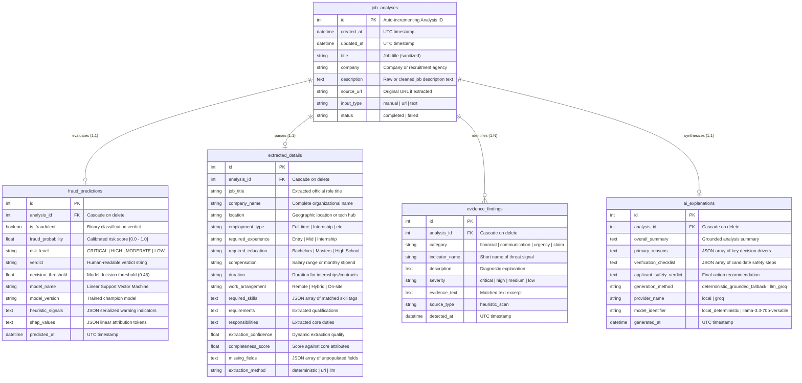

# JobShield AI — Database Architecture & Persistence Specification

This document details the multi-table database architecture, entity relationships, transaction guarantees, and no-API-key lifecycle for **JobShield AI: Explainable AI-Based Fraud Detection for Job & Internship Opportunities**.

---

## 1. Architectural Overview

JobShield AI uses **SQLAlchemy 2.0 ORM** with **SQLite** for zero-dependency local development and out-of-the-box offline operation. The architecture is fully compatible with **PostgreSQL** by updating the `DATABASE_URL` environment variable.

The application operates in **100% offline mode** by default without requiring an external API key (Groq or otherwise). All predictions, heuristic findings, linear feature attributions (SHAP-aligned), and deterministic explanations are calculated locally and stored transactionally.

---

## 2. Entity-Relationship Diagram



---

## 3. Database Tables & Columns

| Table | Purpose | Cascading Deletion |
|---|---|---|
| `job_analyses` | Top-level job analysis session record | Parent |
| `fraud_predictions` | Linear SVM output, calibrated score, SHAP attributions | `ON DELETE CASCADE` |
| `extracted_details` | Context-aware NLP extracted structured job fields | `ON DELETE CASCADE` |
| `evidence_findings` | One row per heuristic threat signal detected | `ON DELETE CASCADE` |
| `ai_explanations` | Structured grounded rationale with honest generation method | `ON DELETE CASCADE` |
| `extraction_results` | Historical audit logs of standalone raw extractions | Independent |

---

## 4. File Location & Initialization

- **Default Location**: `jobshield.db` in the repository root (`C:\Users\Hp\Projects\JobShieldAI\jobshield.db`).
- **Initialization**: Automatically triggered on FastAPI startup via `backend/app/main.py`:
  ```python
  from .db.database import init_db
  init_db()
  ```
- **Alembic Migrations**: Managed via Alembic (`alembic upgrade head`).

---

## 5. REST API Endpoints

| Method | Endpoint | Description |
|---|---|---|
| `POST` | `/api/analyze` | Evaluates job, persists to SQLite, returns `analysis_id` in metadata |
| `GET` | `/api/analyses` | Paginated listing with search by title/company and risk filtering |
| `GET` | `/api/analyses/stats` | Live SQLite counts of total, scam, legit, and high-risk analyses |
| `GET` | `/api/analyses/{id}` | Full relational tree (prediction, details, findings, explanation) |
| `DELETE` | `/api/analyses/{id}` | Cascading deletion of an analysis and all linked records |
| `GET` | `/api/history` | Legacy-compatible endpoint for fast list queries |

---

## 6. Offline / No-API-Key Guarantees

1. When `LLM_PROVIDER=none` (the default), no external HTTP requests are made.
2. Explanations are produced by the local grounded engine and labeled as `generation_method="deterministic_grounded_fallback"`.
3. If Groq is enabled later, any network failure or timeout gracefully falls back to the deterministic engine without breaking the prediction or database persistence.

